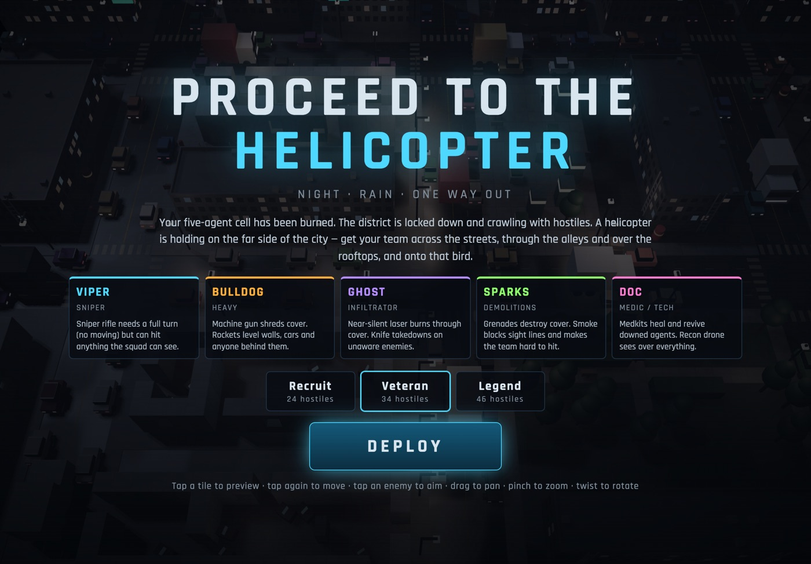
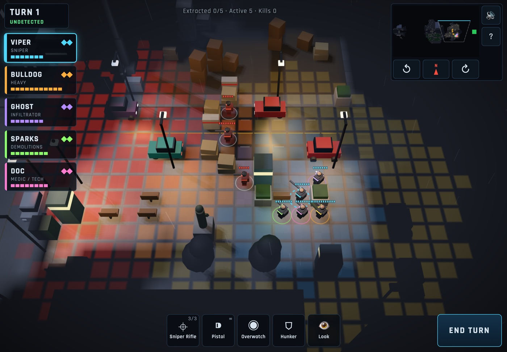
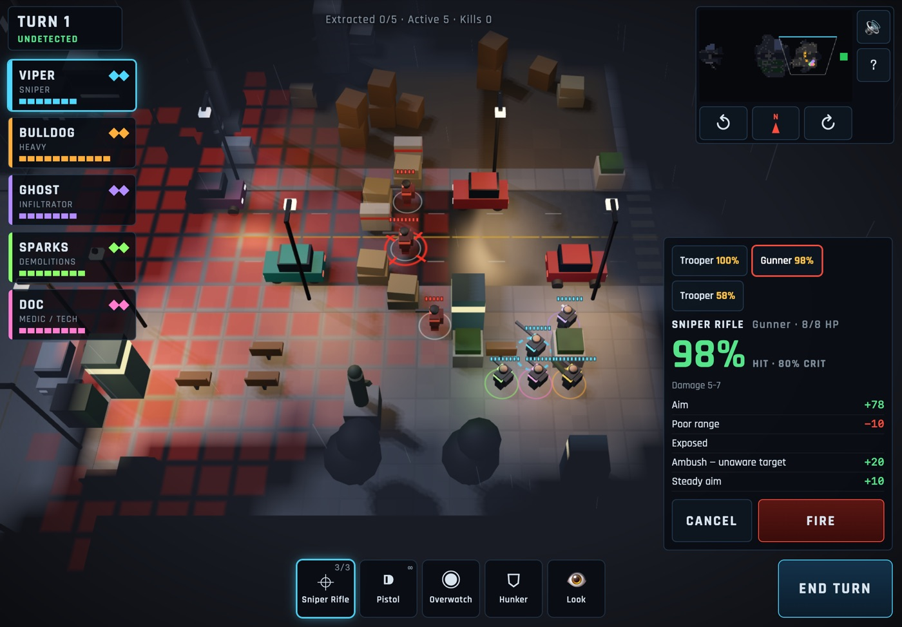
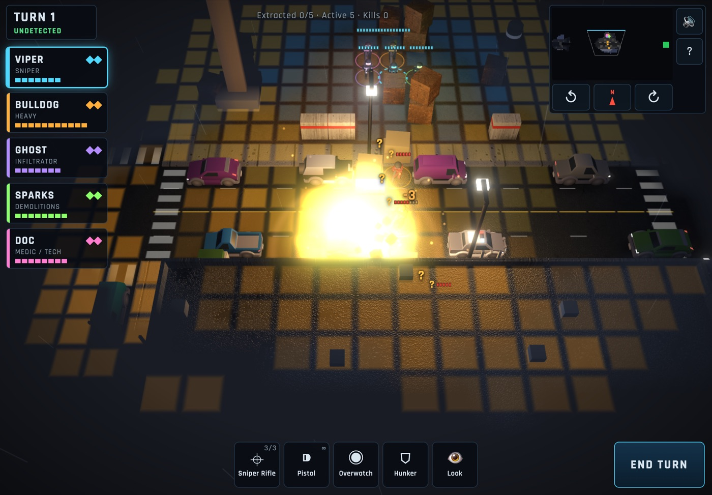
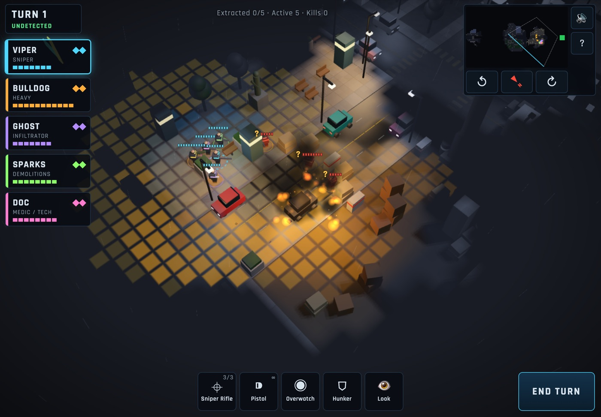
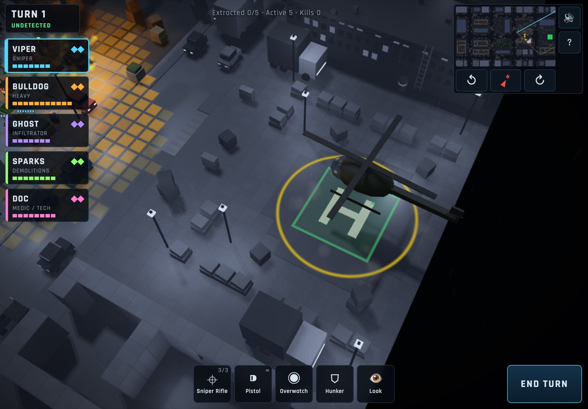
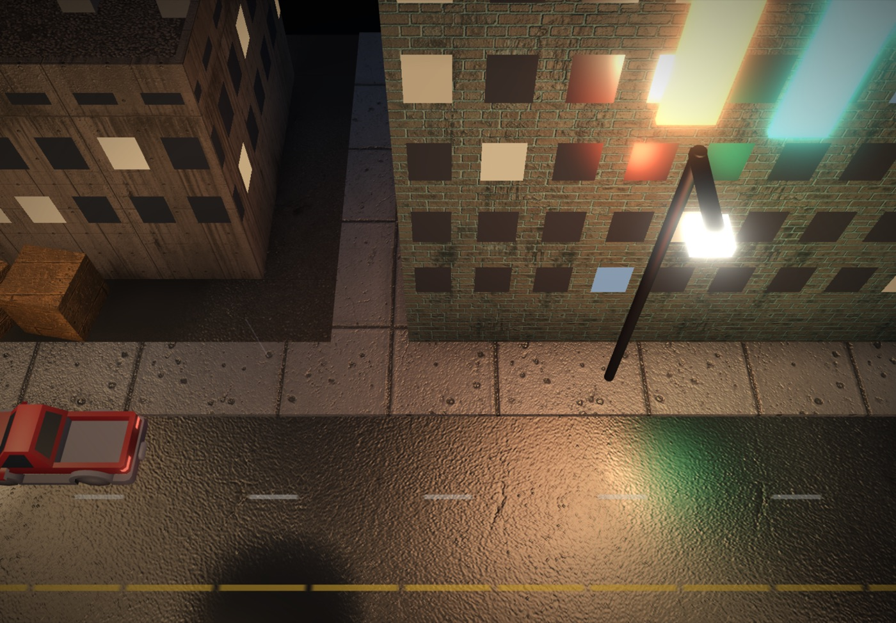

# Proceed to the Helicopter

A turn-based tactics game in the spirit of XCOM, rendered with WebGPU and built touch-first for iPad.

Your five-agent cell has been burned. Get them across a rain-soaked, destructible night city, past dozens of hostiles, to the helicopter waiting on the far side.



## Gameplay

### Stealth first

Each agent sees in a 120° cone, and the rest of the city stays under fog of war. Enemies you can see show their vision cones as red tiles. Lit areas get you spotted from further away, so shooting out street lamps buys you darkness. If an enemy spots you, kill them before the enemy turn or they raise the alarm and reinforcements start arriving.



### Every shot is explained

Hit chance comes from cover, range, smoke and trees in the way, height, darkness and field of view. Shooting an enemy who is unaware or looking the other way is much easier. The panel lists every modifier before you fire.



### The city breaks

Rockets and grenades flatten walls and cover, and agents on a destroyed roof fall. Cars catch fire and explode when shot enough, and set off alarms that lure guards. Fuel barrels, pumps and the tanker chain-react. Missed shots wear down whatever the target is hiding behind.



### Look anywhere

Twist two fingers to rotate the view a full 360°, for example to see around a tall building. The ↺ ↻ buttons turn 90° at a time and the compass faces north again.



### Get to the landing zone

Step an agent onto the green landing zone and press **Extract**. The helipad is ringed with sandbags and guarded. The mission ends when every agent is aboard or down, and your rating depends on how many made it.



## The squad

| Agent | Role | Kit |
|---|---|---|
| **Viper** | Sniper | Sniper rifle (needs a full turn, can hit anything the squad sees), pistol |
| **Bulldog** | Heavy | Machine gun that shreds cover and pins enemies down, 2 rockets, frag grenade |
| **Ghost** | Infiltrator | Near-silent laser pistol that burns through cover, knife takedowns, short-term stealth |
| **Sparks** | Demolitions | SMG, 3 frag grenades, 2 smoke grenades |
| **Doc** | Medic / Tech | Carbine, medkits that heal and revive downed agents, recon drone, smoke grenade |

Enemies include troopers, machine gunners, grenadiers, officers (killing one panics their squad) and snipers. A sniper paints its target with a red laser that shows through the fog, then fires on its next turn unless you break line of sight. There are three difficulties: Recruit (24 hostiles), Veteran (34) and Legend (46).

## Controls

| | iPad | Desktop |
|---|---|---|
| Move | Tap a tile to preview, tap again to go | Click twice |
| Aim | Tap an enemy, check the odds, press **Fire** | Click, then Enter |
| Pan | Drag | Drag, WASD or arrow keys |
| Zoom | Pinch | Mouse wheel |
| Rotate | Twist two fingers, or ↺ ↻ | Q / E |
| Next agent | Tap a squad card | Tab |
| End turn | **End Turn** | Space |

## Run it

```sh
npm run serve        # http://localhost:8080
```

WebGPU only runs in a secure context, meaning `localhost` or HTTPS. An iPad opening the game over plain `http://<lan-ip>` won't get WebGPU, so host it on HTTPS. On iPad it needs Safari on iPadOS 26 or later.

There is no build step. The game is plain ES modules loaded straight from `src/`.

### Deploy to GitHub Pages

`.github/workflows/deploy-pages.yml` publishes the game on every push to `master` (or run it by hand from the Actions tab). GitHub Pages serves over HTTPS, so it works on iPad.

One-time setup: in the repo, go to **Settings → Pages → Build and deployment** and set **Source** to **GitHub Actions**. The game is then served at `https://<user>.github.io/<repo>/`.

## Audio

All sound effects and voice lines are pre-generated with ElevenLabs into `assets/audio/` and played with the Web Audio API, with a radio filter on the squad's voices. The API key is only used when generating, never shipped to the browser.

```sh
npm run audio                              # generate missing files
node tools/generate-audio.mjs --force      # regenerate everything
```

The key comes from `ELEVENLABS_API_KEY` in the environment, or from `ELEVENLABS_API_KEY` or `ELEVEN_LABS_API_KEY` in `.env`. Use the secret key, which starts with `sk_`, not the key ID.

When you select an agent, they answer according to how they are. A downed agent bleeding out on the ground answers with a downed line, an agent at half health or less with a wounded line, and anyone else with their usual line.

To change a line, a voice or a sound prompt, edit `tools/audio-manifest.mjs`, delete the matching `.mp3` and run the generator again.

## Textures

The city's surface textures (asphalt, paving, brick, concrete, graffiti, fly-posters and so on) and the scorch and blood decals were generated with Gemini's image model, `gemini-3.1-flash-image`, and live in `assets/textures/`. The whole set cost about $1.43 to generate. The game uses them as detail maps, so building and floor colours still set the overall tone.



```sh
npm run textures                                   # generate anything missing (key from .env or GEMINI_API_KEY)
python3 tools/generate-textures.py brick graffiti  # regenerate just these
python3 tools/generate-textures.py --process       # re-run the tiling step on cached images, no API calls
```

Prompts are in `tools/texture-manifest.json`. The script makes each texture tile seamlessly: it crops patterns like slabs and bricks to a whole number of repeats, and asks Gemini to repaint the seam when cropping isn't enough. It caches raw output and a cost ledger in `.texture-cache/`, which is gitignored, and stops before spending more than `--cap` (default $4.50). It needs Python 3 with Pillow and NumPy. Generated images carry Google's invisible SynthID watermark.

## Vehicles

Cars and trucks are from [Kenney's Car Kit](https://kenney.nl/assets/car-kit) (CC0, free; thanks Kenney). `tools/build-vehicles.py` converts the kit's GLB models into a single file, `assets/vehicles/vehicles.json` (378 KB of mesh data, stored as base64). The game repaints each body in its own car colours, while taxis, police cars, ambulances, garbage trucks and fire engines keep their livery. Glass is darkened, the lamps glow, police lights flash, and wrecks burn black. Faces the top-down camera never sees are dropped, and wheels become simple tyres, so a car is about 700 triangles. Buses and tankers aren't in the kit and stay box-built.

```sh
# download the kit from kenney.nl, unzip it, then:
python3 tools/build-vehicles.py "/path/to/kenney_car-kit/Models/GLB format"
```

## How it's built

| File | Role |
|---|---|
| `src/renderer.js` | WebGPU renderer: instanced meshes, cached shadow map, point lights, wet-street reflections, fog of war, decals, particles and beams |
| `src/scene.js` | Turns the city into geometry and lights, in 10×10-tile chunks for frustum culling |
| `src/textures.js` | Texture layers and how far each one repeats |
| `src/vehicles.js` | Which vehicle model each car or truck gets |
| `src/mapgen.js` | Procedural city, vehicles and enemy placement |
| `src/map.js` | Tiles, height-aware line of sight, cover, pathfinding, destruction |
| `src/game.js` | Turns, vision, stealth, combat, explosions, abilities |
| `src/ai.js` | Enemy patrols, investigation, cover-seeking combat, sniper lasers |
| `src/fx.js` | Particles, tracers, lasers, debris, projectiles, rain |
| `src/ui.js`, `src/input.js` | HUD, minimap, touch gestures |
| `src/audio.js` | Sound playback and the radio voice chain |

Rendering notes:
- Only the visible part of the city is drawn.
- Building shadows are rendered once and only redrawn when something is destroyed.
- Pixels in unexplored fog skip lighting entirely.
- Lights are binned per tile, so each pixel only loops over the few lights that can reach it.
- Surfaces get normal maps derived from their textures when the game loads, so joints, cracks and bricks catch the light, and rain lingers in the grooves.
- Contact shadows darken the ground where it meets walls, cars and props. They come from a per-tile map stored alongside the fog of war.
- Bloom makes fire, neon, lamps and muzzle flashes glow. It runs at half resolution and below.
- Agents and enemies are posed procedurally every frame from a simple jointed rig. They walk in step with their speed, crouch behind low cover, hunker down, raise their weapons to aim, recoil, flinch when hit, and fall when they go down.
- Fire particles are pooled and budgeted, so a street of burning cars costs about the same as a few.
- The game lowers its render resolution if it can't hold about 40 fps.
